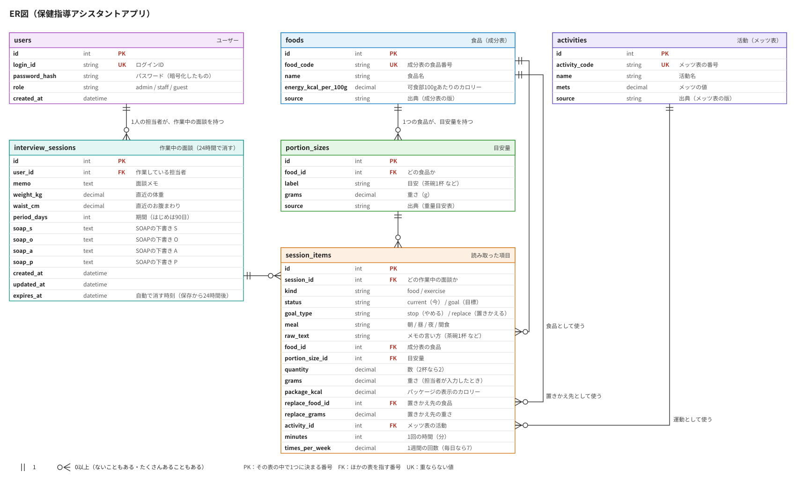

# ER図（データベースの設計）

保健指導アシスタントアプリのデータベースに、どんな表を作るかの設計です。

## 方針

- **対象者の氏名など、個人を特定できる情報は保存しない**
- **計算結果（カロリーや体重が減る見込み）は保存しない**。読み取った項目と、成分表・目安量・メッツ表があれば、計算のルール（[rules.md](rules.md)）でいつでも計算し直せるため
- **作業中の面談は一時保存**。担当者は同時に複数持てて、始めた時刻で見分ける。「カルテに貼り終えた」ボタンを押したとき、または保存から24時間たったときに消す。ゲストも同じ

## 図

## 表の説明

| 表 | 何を入れるか |
| --- | --- |
| users（ユーザー） | ログインする人。役割は、管理者・指導担当者・ゲストの3つ |
| foods（食品） | 日本食品標準成分表の食品と、100gあたりのカロリー |
| portion_sizes（目安量） | 「茶碗1杯＝何g」の表。重量目安表の値を、出典つきで入れる。管理画面で直せる |
| activities（活動） | メッツ表の活動と、メッツの値 |
| interview_sessions（作業中の面談） | 担当者が今作業している面談の、メモ・体重・お腹まわり・期間・SOAPの下書き。一時保存用 |
| session_items（読み取った項目） | AIがメモから読み取り、担当者が確認・修正した、食事・運動・目標の1つ1つ |
