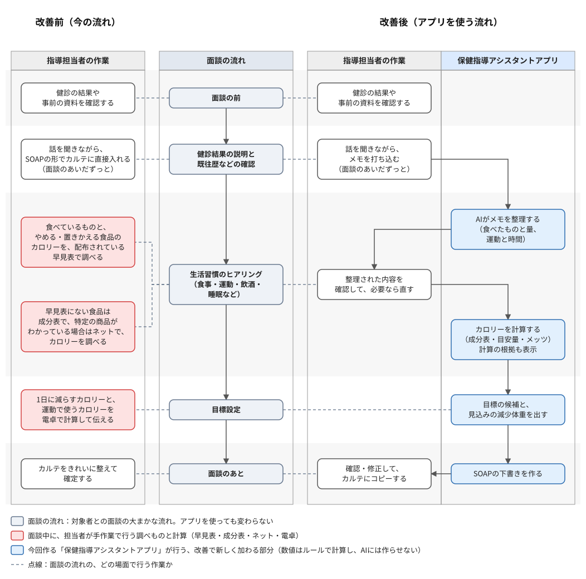

# 業務フロー（改善前・改善後）

特定保健指導の面談で、指導担当者が行う作業の流れです。真ん中が面談の流れ、左が今の担当者の作業、右が「保健指導アシスタントアプリ」を使ったときの作業です。

## 変わるところ

- 今は、面談中の限られた時間の中で、担当者が、配布されているカロリー早見表を使用し、早見表にない食品は成分表で、特定の商品がわかっている場合はネットでカロリーを調べ、減らすカロリーや運動のカロリーを電卓で計算している（赤い作業）
- 保健指導アシスタントアプリを使うと、メモの整理、カロリーの計算、目標の候補と見込みの減少体重、SOAPの下書きを、アプリが行う（青い作業）
- 調べものと計算をアプリに任せることで、ヒアリングや相談に時間を使えるようにする

## 変わらないところ

- 面談の流れ（健診結果の説明と既往歴などの確認、生活習慣のヒアリング、目標設定）は、今までどおり
- 目標は、今までどおり担当者が対象者と一緒に決める
- 数値はアプリのルールで計算し、AIには作らせない
- AIが整理した内容やカルテの下書きは、担当者が確認・修正してから使う
